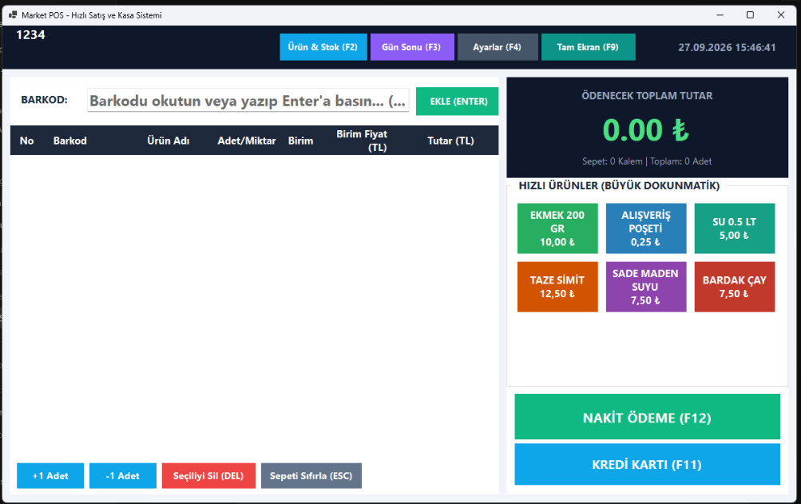

# 🛒 MarketPOS - Hızlı Satış ve Stok Yönetim Sistemi

<p align="center">
  
</p>

<p align="center">
  
  
  
  
  
  
</p>

Bakkal, market, büfe ve perakende satış noktaları için özel olarak geliştirilmiş; **BİM ve A101 tarzı ergonomiye sahip**, **Windows 7 ve 1 GB RAM'li eski kasalarda dahi takılmadan çalışan** modern, ultra hafif ve açık kaynaklı masaüstü satış ve stok yönetim yazılımı.

---

## ⚡ Neden MarketPOS?

Piyasadaki pek çok market yazılımı ya ağır tarayıcı motorları (Electron vb.) yüzünden yüzlerce megabayt RAM tüketir ya da SQL Server gibi karmaşık veritabanı kurulumlarına ihtiyaç duyar. 

**MarketPOS**, eski nesil atom işlemcili kasa bilgisayarlarında dahi **1 saniyede açılır**, **~35 MB RAM** tüketir ve hiçbir harici servis/sunucu kurulumu gerektirmeden tek tıkla çalışır.

---

## 🚀 Öne Çıkan Özellikler

### 🔫 1. Kesintisiz Donanımsal Barkod Okuma (Global Barcode Capture)
* **Sıfır Fare Dokunuşu:** Kasiyer ekranda nereye tıklamış olursa olsun (ürün tablosu, butonlar veya boş alan), barkod tabancasından gelen ilk hanede imleç anında barkod kutusuna odaklanır ve okuma tamamlanır.
* **Çarpanlı Hızlı Satış:** `5*barkod` veya `10xbarkod` yazılarak aynı üründen saniyeler içinde toplu adet eklenebilir.
* **Görsel Hazır Göstergesi:** Barkod kutusu aktif olduğunda yumuşak sarı ışıkla aydınlanır ve kasanın okumaya hazır olduğunu bildirir.

### 💻 2. Windows 7'den Windows 11'e %100 Yerel Destek (Multi-Targeting)
* **Windows 7 SP1 Yerel Sürümü (.NET Framework 4.8):** Modern .NET sürümlerinin Windows 7'de verdiği `KERNEL32.dll / SetThreadDescription bulunamadı` veya `0xc0000139` hatalarını tamamen bertaraf eder. Tüm bağımlılıklarıyla birlikte **sadece 2.5 MB** boyuttadır.
* **Windows 10 / 11 Standalone Sürümü (.NET 10):** En yeni .NET 10 çalışma zamanını kendi içinde barındırır, hedef bilgisayarda .NET kurulu olmasa bile kurulumsuz çalışır.

### 🛡️ 3. Akıllı Stok Aşım Koruması & Eksi Stok Önleme
* Bir ürünün stoğu tükendiğinde veya sepetteki miktar mevcut stoğu aştığında anında **Stok Uyarı Ekranı (`StockWarningDialog`)** açılır.
* Kasiyere mevcut stok, sepetteki toplam ve aşılan miktar net rozetlerle gösterilir.
* Kasiyer ister tek tuşla ek onay verip devam edebilir (`Enter`), isterse **[Kalan Stoğu Ekle]** diyerek stoğun eksiye düşmesini önleyebilir.
* Ürünler ekranındaki **[Eksi Stokları Sıfırla]** butonu ile daha önce eksiye düşmüş tüm ürünlerin stoğu tek tıkla `0` olarak düzeltilebilir.

### 💵 4. Esnek Nakit & Para Üstü Yönetimi
* **Gelişmiş Para Üstü Ekranı (F12):** Alınan paraya tıklandığında devasa dijital LED ekran formatında verilecek para üstünü gösterir.
* **Hızlı Kasa Modu:** İsteğe bağlı olarak **Ayarlar** menüsünden para üstü hesaplama ekranı kapatılabilir; F12'ye basıldığında doğrudan nakit satış tamamlanır.
* **Kredi Kartı ile Tek Tuş Satış (F11):** Anında kredi kartı tahsilatını onaylar ve fiş kaydını oluşturur.

### ☁️ 5. Telegram Otomatik Bulut Yedekleme (Anti-DNS Sansür Koruması)
* `market_pos.db` veritabanını belirli periyotlarla (30 dk, 1 saat, gün sonu) veya tek tıkla Telegram botunuza otomatik olarak gönderir.
* **Akıllı DNS Fallback:** Türkiye'deki servis sağlayıcıların DNS engellemeleri veya `api.telegram.org` çözememe sorunlarına karşı **Telegram resmi IP'lerine (`149.154.166.110`) doğrudan soket bağlantısı** kurarak yedeğin iletilmesini garanti eder.

### 🖨️ 6. Fiş Yazıcı, Kasa Çekmecesi & Kiosk Tam Ekran
* **ESC/POS Uyumlu:** Satış tamamlandığında fiş çıktısı üretir ve para çekmecesini otomatik tetikleme sinyali verir.
* **Tam Ekran Kasa Modu (F9):** Windows görev çubuğunu gizleyen tam ekran kiosk moduna geçerek kasiyerin dikkatini sadece satışa odaklar.

---

## ⌨️ Klavye Kısayolları

Kasiyerin fareye dokunmadan kasayı yönetebilmesi için tasarlanmıştır:

| Tuş | Fonksiyon | Açıklama |
|---|---|---|
| **Enter** | Sepete Ekle / Onayla | Barkodu sepete ekler veya onay pencerelerini onaylar. |
| **5\*Barkod** | Çarpanlı Satış | Örn: `5*8690504...` yazıldığında aynı üründen 5 adet ekler. |
| **F1** | Barkod Odaklan | İmleci anında barkod okutma kutusuna çeker. |
| **F2** | Ürün & Stok Girişi | Yeni ürün kaydetme, stok artırma ve fiyat güncelleme ekranı. |
| **F3** | Raporlar & Z Raporu | Günlük ciroyu, nakit/kart dağılımını ve geçmiş fişleri listeler. |
| **F4** | Ayarlar | Market adı, Telegram bulut yedekleme, kasa tercihleri. |
| **F9** | Tam Ekran (Kiosk) | Görev çubuğunu gizleyen çerçevesiz tam ekran modunu açar/kapatır. |
| **F11** | Kredi Kartı Satış | Kredi kartı tahsilatını tek tuşla tamamlar. |
| **F12** | Nakit Satış | Hızlı para butonları ile nakit tahsilat ve para üstü hesaplar. |
| **+ / -** | Miktar Değiştir | Sepette seçili ürünün adedini 1 artırır veya azaltır. |
| **Çift Tıklama** | Adet Düzenle | Sepetteki adet hücresine çift tıklayarak miktarı hızlı çiplerle düzenler. |
| **DEL** | Seçiliyi Sil | Sepette seçili olan kalemi çıkarır. |
| **ESC** | İptal / Temizle | Açık pencereleri kapatır veya sepeti sıfırlar. |

---

## 📂 Proje Mimarisi

```text
MarketPOS/
├── src/MarketPOS/
│   ├── Data/
│   │   ├── DatabaseContext.cs         # SQLite bağlantı yöneticisi, şema ve başlangıç verileri
│   │   └── Repositories/
│   │       ├── ProductRepository.cs   # Ürün ve stok işlemleri, arama, eksi stok sıfırlama
│   │       ├── SaleRepository.cs      # Satış kaydı, fiş detayları, günlük ciro özetleri
│   │       └── SettingsRepository.cs  # SQLite + config.json çift katmanlı ayar yönetimi
│   ├── Forms/
│   │   ├── MainForm.cs                # Ana kasa satış ekranı ve global tuş yakalayıcı
│   │   ├── ProductForm.cs             # Ürün tanımlama, filtreleme, stok ekleme penceresi
│   │   ├── PaymentDialog.cs           # Nakit ödeme ve büyük LED para üstü ekranı
│   │   ├── StockWarningDialog.cs      # Stok aşım uyarı ve kasiyer ek onay diyaloğu
│   │   ├── ReportForm.cs              # Gün sonu Z raporu ve satış geçmişi ekranı
│   │   └── SettingsForm.cs            # Kasa tercihleri ve Telegram bulut yedekleme ayarları
│   ├── Models/                        # CartItem, Product, Sale, SaleItem modelleri
│   ├── Services/
│   │   ├── ReceiptService.cs          # ESC/POS fiş şablonu oluşturucu
│   │   ├── SoundService.cs            # Kasa bip ve çekmece sesleri
│   │   └── TelegramBackupService.cs   # DNS fallback destekli bulut yedekleme servisi
│   └── UI/
│       ├── Theme.cs                   # Renk paleti, modern buton ve grid stilleri
│       └── ControlExtensions.cs       # Win7 & Win10/11 yerel TextBox placeholder eklentisi
└── tests/MarketPOS.Tests/
    └── PosBusinessTests.cs            # İş mantığı, stok, sepet ve ayar xUnit testleri (13/13)
```

---

## 🛠️ Kurulum ve Geliştirici Kılavuzu

### Gereksinimler
* [.NET 10 SDK](https://dotnet.microsoft.com/download) (Geliştirme ve derleme için)
* Windows 7 SP1 veya üzeri işletim sistemi

### Projeyi Klonlayın ve Derleyin
```powershell
git clone https://github.com/muhammetdag/MarketPOS.git
cd MarketPOS

# Windows 10/11 için çalıştırma
dotnet run --project src/MarketPOS/MarketPOS.csproj -f net10.0-windows

# Windows 7 için çalıştırma
dotnet run --project src/MarketPOS/MarketPOS.csproj -f net48
```

### Otomatik Testleri Çalıştırma
```powershell
dotnet test tests/MarketPOS.Tests/MarketPOS.Tests.csproj
```

### Yayın (Release) Paketleri Üretme
```powershell
# 1. Windows 7 SP1 için ultra hafif sürüm (2.5 MB)
dotnet publish src/MarketPOS/MarketPOS.csproj -c Release -f net48 -o publish-win7

# 2. Windows 10 / 11 için kurulumsuz taşınabilir sürüm (Standalone)
dotnet publish src/MarketPOS/MarketPOS.csproj -c Release -f net10.0-windows -r win-x64 --self-contained true -o publish-standalone
```

---

## 🤝 Katkıda Bulunma (Contributing)

1. Bu depoyu Fork'layın (`fork`).
2. Yeni özelliğiniz için bir dal oluşturun (`git checkout -b feature/YeniOzellik`).
3. Değişikliklerinizi commit edin (`git commit -m 'feat: Yeni özellik eklendi'`).
4. Dalınıza push yapın (`git push origin feature/YeniOzellik`).
5. Bir **Pull Request (PR)** açın.

---

## 📄 Lisans

Bu proje **[MIT Lisansı](LICENSE)** altında lisanslanmıştır. Ticari ve kişisel amaçlarla özgürce kullanılabilir, değiştirilebilir ve dağıtılabilir.
